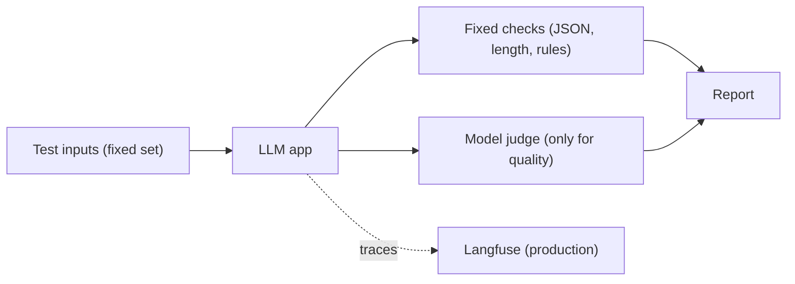

<TLDR>
An LLM app gives different wording on each run, so a plain equality check does not work. Start with fixed checks on the shape and content of the output. Add a model-based judge only for quality questions that fixed checks cannot answer. Four open tools cover this area: Promptfoo, DeepEval, Ragas and Langfuse.
</TLDR>

## What and why

An LLM feature takes text in and returns text out. A RAG app first fetches documents from a search index, then asks the model to answer using them. RAG stands for retrieval-augmented generation. Testing it has three layers:

1. **Shape and rules:** is the output valid JSON, short enough, free of forbidden content, and free of data the user cannot see?
2. **Retrieval:** did the search step return the right documents?
3. **Answer quality:** is the answer faithful to the documents, and does it answer the question?

Layer 1 is cheap and repeatable. Layers 2 and 3 often use a second model as a judge, called LLM-as-a-judge. A judge is also not exact. Its scores can drift when the judge model changes.

## The four tools

| Tool | What it does | Licence | Latest release (as of 2026-11-06) |
|---|---|---|---|
| Promptfoo | CLI and library for evaluating and red-teaming LLM apps, with YAML test configs | MIT | 0.125.1, 2026-10-25 |
| DeepEval | LLM evaluation framework, similar to Pytest, run with `deepeval test run` | Apache-2.0 | python-v4.2.4, 2026-09-22 |
| Ragas | Python library of metrics for RAG pipelines | Apache-2.0 | v0.4.3, 2026-01-13 |
| Langfuse | Tracing, prompts, datasets and evals for LLM apps; self-hostable | MIT, except the `ee` folders | v4.76.0, 2026-11-05 |

DeepEval says that "almost all predefined metrics" use LLM-as-a-judge. Promptfoo offers both fixed assertions (such as `is-json`, `contains` and `regex`) and model-graded ones (such as `llm-rubric`). Ragas describes its library as a set of metrics, and the exact metric names change between versions, so check the docs for the version you install. Langfuse records traces of each model call, so you can see what the app sent and got back.

## How it works



The fixed checks run on every commit. The judge runs on a smaller set, because it costs money and varies.

## TaskFlow example: a feature that does not exist yet

The local TaskFlow app has **no** "summarise my tasks" feature. It has no LLM calls at all. Do not add one to the code to make this chapter work. If you build such a feature later, these are the checks to write for it:

- The summary is non-empty and under a set length.
- It only mentions tasks the signed-in user can see.
- It does not reveal another user's data.

The check below is pure Python. It needs no model and no API key. It is a sketch of the fixed-check layer, and it runs as written.

```python
import re

def check_summary(summary: str, allowed_task_ids: set[int]) -> list[str]:
    problems = []
    if not summary.strip():
        problems.append("summary is empty")
    if len(summary) > 1000:
        problems.append("summary is longer than 1000 characters")
    cited = {int(n) for n in re.findall(r"#(\d+)", summary)}
    unknown = cited - allowed_task_ids
    if unknown:
        problems.append(f"summary cites tasks the user cannot see: {sorted(unknown)}")
    return problems
```

Promptfoo can express the same kind of rule in its config, using assertion strings such as `is-json` or `not-contains:password`. Promptfoo needs a model provider to run a test, so it is not part of the no-key examples in this handbook.

## When to use it (and when not to)

| Use it when | Skip it when |
|---|---|
| Output must follow a format (JSON, a fixed structure) | You can check the output with a rule. Use the rule |
| Quality is subjective and a human reviews a sample | No human will read the judge's scores |
| You change a prompt or a model and need to compare versions | The app is not yet in use and nothing has changed |
| You need to trace what the app sent to a model in production | The data is personal and no approved storage exists |

## Do this

- Write fixed checks first, then add judge checks for the rest.
- Keep a small golden set of inputs and expected properties, and version it in Git.
- Pin the judge model and record its name in every report.
- Run the cheap checks on every pull request. Run the judge on a schedule or on prompt changes.
- Use Langfuse or similar tracing in production, with personal data removed.

## Avoid this

- Asserting exact wording of an LLM answer. Small changes will break the test with no real bug.
- Trusting one judge score. Look at the failing examples.
- Testing the model in isolation and never testing the app around it.

:::tip[Recommendation]
Start with fixed checks and a golden set of about a few dozen inputs, then grow it when production shows a new failure type. This is a team habit, not a published standard.
:::

## Further reading

- [Promptfoo introduction](https://www.promptfoo.dev/docs/intro/). Describes the tool as "an open-source CLI and library for evaluating and red-teaming LLM apps". Fetched 2026-11-06.
- [DeepEval quickstart](https://deepeval.com/docs/getting-started). Describes the pytest-style run. Fetched 2026-11-06.
- [Ragas documentation](https://docs.ragas.io/en/stable/). Fetched 2026-11-06; the page did not list metric names, so check the metrics reference for your version.
