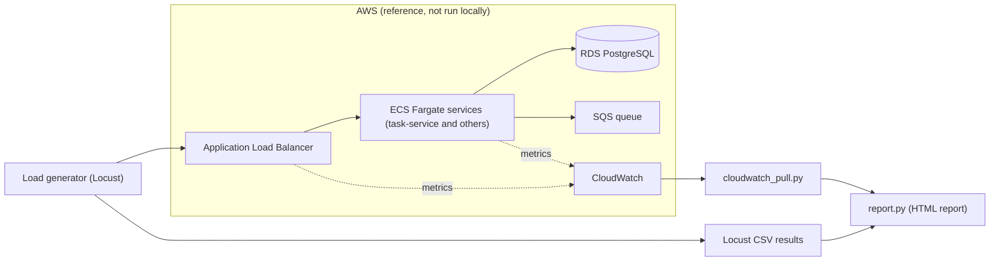

<TLDR>
This runbook links the handbook's tools into one flow. Steps 1 to 3 run on your laptop against local TaskFlow. Steps 4 to 6 use AWS data and the ECS capacity scripts. You run step 4 only against an environment you deployed yourself. Nothing here is measured on a live system.
</TLDR>

## What and why

Each earlier chapter covers one skill. This capstone puts them in order. You check that the API behaves, measure how it responds under load, pull the matching infrastructure metrics, work out how many ECS tasks you need, and write a report someone can read in a minute.

The local part runs fully on your machine. The AWS part needs credentials and a stack you deploy yourself. The handbook does not deploy anything for you.

## Architecture

The reference architecture is the one in the [TaskFlow reference](/start-here/taskflow-reference). The diagram shows the load test and the reporting path around it.

Locally, the load generator talks straight to the FastAPI app on port 8000. There is no ALB, ECS, RDS, SQS or CloudWatch on your machine.

## Repo layout

| Path | Contents |
|---|---|
| `examples/taskflow/` | Local FastAPI app, UI, Postgres compose file |
| `examples/taskflow/tests/test_taskflow_api.py` | Pytest API tests (19 tests) |
| `examples/taskflow/loadtest/locustfile.py` | Locust user behaviour |
| `examples/ecs-capacity/cloudwatch_pull.py` | Pulls CloudWatch metrics (not run locally) |
| `examples/ecs-capacity/capacity.py` | Capacity calculation |
| `examples/ecs-capacity/report.py` | Builds the HTML report |

## Runbook

Run these steps in order. Use the `.venv` that already exists in `examples/taskflow/`.

1. **Start local TaskFlow and run the API tests.** Activate the venv, then run `pytest -q` from `examples/taskflow/`. The suite covers login, the title and priority rules, the status flow, project membership and delete. Fix any failure before you load test.

2. **Start the app for load testing.** In a second terminal, run `uvicorn app.main:app --reload` from `examples/taskflow/`. Check that `http://localhost:8000/health` returns `ok`.

3. **Run the Locust smoke test.** From `examples/taskflow/`, run the command in the README, with `--csv results/smoke`. It runs 10 users for one minute. Keep the CSV files. They are the input to step 6. This is a smoke test, so it checks that the scripts work. It does not find the capacity limit.

4. **Pull CloudWatch metrics (AWS only).** Read the header of `examples/ecs-capacity/cloudwatch_pull.py` for its arguments. Run it only against a stack you deployed yourself, with the same time window as the load test. It needs AWS credentials and does not run in this handbook's local setup.

5. **Calculate the task count.** Run `examples/ecs-capacity/capacity.py` with the per-task capacity you measured in one-task tests. It applies the formula from [Per-task capacity and task count](/ecs-performance/per-task-capacity-and-task-count): tasks = peak requests per second ÷ requests per second per task × headroom.

6. **Build the HTML report.** Run `examples/ecs-capacity/report.py` with the Locust CSV files and, if you ran step 4, the CloudWatch data. Open the HTML file and check the pass or fail verdict against your SLOs before you share it. The report layout follows [The performance report](/ecs-performance/performance-report).

Keep each run's output in its own folder, named by date and scenario, so you can compare runs later.

## Worked example

:::info[Illustrative data]
The figures below are made up to show the arithmetic. They are not results from a run.
:::

Suppose a planning target says the service must handle 600 requests per second at peak. A one-task test shows that one task handles 50 requests per second while meeting its latency SLO. You want 30 percent headroom.

- Base count: 600 ÷ 50 = 12 tasks.
- With headroom: 12 × 1.3 = 15.6, so round up to 16 tasks.

The rounding and headroom values are choices you make and record in the report. They are not standards.

## Do this

- Keep the local runs (steps 1 to 3) green before you touch AWS data.
- Record the app version, the task count and the test duration with every report.
- Read the report's verdict and its evidence together. One metric is not enough to change task count.
- Keep all AWS steps behind a stack you own, with a budget and a stop time.

## Avoid this

- Running load tests against a shared or production environment. See [Test environments](/modern-quality-engineering/test-environments).
- Treating the local smoke run as capacity evidence. It tells you the scripts work.
- Changing production scaling settings from a script's output. Humans review every change.
