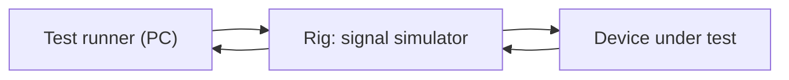

<TLDR>
Embedded software runs inside a device, such as a sensor, a controller or a connected appliance. An IoT device also talks to a cloud service over a network that may drop at any time. Testing these systems mixes real hardware, simulators and cloud-side checks, and must cover field updates, network loss, battery and memory limits.
</TLDR>

Concepts only. Nothing on this page was run here.

## What and why

An embedded device has a small processor, limited memory and a job to do, often with no screen. An IoT device adds a network connection. Three facts shape testing:

- **Hardware is slow to get and easy to break.** You cannot test every build on every board on every desk.
- **Devices sit in the field for years.** A bug that ships is expensive to fix, because fixing it means an update to a device you may not be able to reach.
- **Failure is normal.** Power drops, radio links fail and batteries run down. Good firmware expects this.

## How it works

Teams usually test in layers, from the desk to the real device:

- **Software-only tests** run the control code on a development computer. They check logic, but not timing or hardware.
- **Simulators** stand in for the device or the environment. A simulator can produce sensor values or fake a slow network.
- **Hardware-in-the-loop (HIL)** runs the real controller connected to a rig. The rig feeds it signals and records what it does.
- **Field tests** run on real devices in real places, such as a test vehicle or a pilot site.

A **device twin** is a cloud copy of a device's last reported state and its desired settings. Tests can change the desired state in the cloud and check that the device applies it. The exact features depend on the cloud provider, so check the provider's own documentation before you design tests around them.

## Field updates

Updating firmware in the field is a test problem in its own right. Check these cases:

- The update succeeds and the new version reports itself.
- The power is cut halfway through. The device must still boot, either on the old version or on the new one.
- The new version fails its health check. The device must roll back.
- The update is rolled out in stages, with a small group first.

Keep a record of which version each device runs. Without it, a rollback cannot be checked.

## Network loss

A device on a mobile or radio link loses its connection often. Test that:

- Readings are stored on the device while offline, then sent in order when the link returns.
- Retries back off and do not flood the network.
- Commands sent while the device is offline are either applied late or rejected, and never silently lost.

[Reliability, resilience and chaos engineering](/other-non-functional/reliability-and-chaos) covers the general method for injecting these failures.

## Battery and memory limits

Limits are part of the requirement. Measure them on real hardware:

- Current draw in each mode, such as idle, sending and sleeping.
- Free memory after a long run. A slow leak can take weeks to show.
- Behaviour when a watchdog timer, which resets a stuck device, fires during a test.

Safety-related products usually fall under safety standards for their industry. Involve your safety team early, because those standards set what evidence you must keep.

## TaskFlow example

:::info[Illustrative data]
TaskFlow has no device. This example imagines a wall badge that shows the top task for a team and syncs through the cloud. The numbers and steps are invented for illustration and were not run.
:::

Imagine three tests for the badge:

- Put the badge on a rig with the network switched off for 20 minutes. Move a task to a new status in the TaskFlow API while the badge is offline. When the link returns, check that the badge shows the new top task within the agreed time.
- Cut power during a firmware update, reboot, and check that the badge still shows a valid version.
- Run the badge for a simulated week on the bench and check that free memory does not fall.

The API side of the badge reads tasks through the endpoints in the [TaskFlow reference](/start-here/taskflow-reference).

## Do this

- Test the control logic on a PC first, then confirm timing on the rig.
- Make every update reversible, and test the rollback.
- Store readings locally when the network is down, and test the order when they are sent.
- Record the firmware version on every test run.
- Recommendation: run the power-cut and network-loss tests on every release candidate, not only at the end.

## Avoid this

- Assuming a simulator shows real timing. Simulators often hide it.
- Shipping an update path that has never been interrupted in a test.
- Measuring battery life on one bench unit only.
- Treating a device twin as the device. The twin shows what was reported, not what the hardware did.

## Further reading

No external sources were checked for this page, so none are listed. Related pages in this handbook:

- [Test doubles and service virtualization](/automation-engineering/test-doubles-and-service-virtualization), for the stand-ins used in simulators.
- [Security testing](/other-non-functional/security-testing), because device updates and cloud links are attack surfaces.
