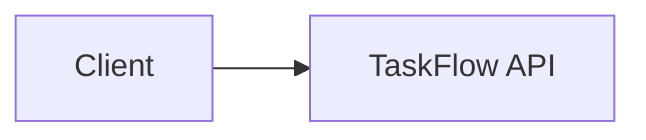

<TLDR>
Two or three plain-English sentences. What it is, and why you care.
</TLDR>

## What and why

What it is, and the problem it solves. Short sentences. Explain jargon once.

## How it works

Add a Mermaid diagram ONLY if it explains the idea faster than text:



## When to use it (and when not to)

| Use it when | Skip it when |
|---|---|
| ... | ... |

## TaskFlow example

A concrete example using TaskFlow (see [the TaskFlow reference](/docs/start-here/taskflow-reference)).

```python
# Runnable where possible. Point to examples/taskflow/ when it exists there.
```

## Do this

- Practice 1
- Practice 2
- Practice 3

## Avoid this

- Mistake 1
- Mistake 2

## Further reading

Only links that were opened and verified. Omit this section if there are none.
